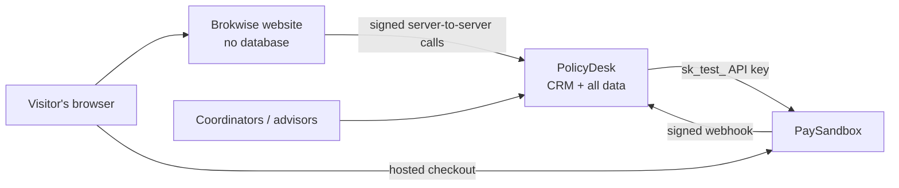

# Brokwise knowledge base

Brokwise is a made-up insurance broker's public website. It sells four lines of business: **car,
travel, home and health**, all through one config-driven journey (step 6). It is a demo merchant for PaySandbox (a fake payment gateway) and uses
PolicyDesk (an insurance CRM) as its back office. All people, insurers and numbers are made up.

Pages in this folder:
- this overview: what Brokwise is, the three systems, the journeys and what steps 1 to 6 ship;
- [engineering-highlights.md](engineering-highlights.md): the decisions beyond "it works" (security,
  payments, business rules, delivery) and where each is tested;
- [future-scope.md](future-scope.md): what is planned later and what triggers it.

The full design is in [`docs/superpowers/specs/2026-11-11-brokwise-design.md`](../superpowers/specs/2026-11-11-brokwise-design.md).

## The three systems

| System | Owns |
| --- | --- |
| **Brokwise website** (this repo) | Marketing and journey pages, forms, the plans page, the payment page and the thank-you page. Stores nothing except a signed journey cookie. Never talks to PaySandbox's API. |
| **PolicyDesk** | All data: opportunities, leads, plans, orders, payments, automatic assignment and the audit timeline. The private website API. The only holder of the PaySandbox key. |
| **PaySandbox** | Checkout sessions, hosted checkout, payment events and webhooks. |

The website never writes to PolicyDesk's database. Every call goes to PolicyDesk's private API under
`/api/website/v1/`, signed with a shared secret:

- headers `x-brokwise-timestamp` (unix seconds) and `x-brokwise-signature` (lowercase hex);
- signature = HMAC-SHA256(`WEBSITE_API_SECRET`, `${timestamp}.${METHOD}.${pathAndQuery}.${rawBody}`);
- PolicyDesk refuses a request that is unsigned, wrongly signed, or more than 5 minutes off its clock.

The code is in `src/lib/signature.ts` (signing) and `src/lib/policydesk.ts` (the client).

## Journeys

**A. Self-serve ("Get prices now")**
1. The visitor fills the full form (car, driver, contact). PolicyDesk creates the opportunity and the
   lead together and assigns a coordinator automatically.
2. The visitor goes straight on to the car plans, ticks add-ons and picks one. PolicyDesk prices the
   choice and saves it on the lead as a quote (step 2).
3. The visitor pays on PaySandbox's hosted checkout (step 3). PaySandbox tells PolicyDesk by a signed
   webhook; PolicyDesk marks the order paid, accepts the quote and assigns an advisor automatically.
4. The thank-you page shows the paid order and the advisor.

**B. Assisted ("Call me back")**
1. The visitor fills the short form (name, mobile, email, car make, model, year). PolicyDesk creates the
   opportunity only and assigns a coordinator automatically.
2. The coordinator calls the customer, completes the car and driver details in PolicyDesk, qualifies the
   opportunity and converts it to a lead (no advisor yet).
3. With the customer, the coordinator picks the plan and add-ons in PolicyDesk and creates a private
   payment link, `brokwise.vercel.app/pay/<token>`, which they send to the customer (step 4).
4. The customer opens the link and pays on the same payment and thank-you pages as journey A.

One rule for both: the coordinator owns everything before payment; the advisor comes in after payment.

## What step 1 ships

| Page | What it does |
| --- | --- |
| `/` | Home: lines of business as cards (only Car is active), a made-up trust strip. |
| `/car` | Choice between "Get prices now" (full form) and "Call me back" (short form). |
| `/car/quick` | Short form. |
| `/car/details` | Full form. |
| `/car/received` | "Request received": lead reference (full form), next steps, and the coordinator card in the header, or the help desk card when nobody is available. |

Every form page shows: "Demo site: use made-up details. Payments are in PaySandbox test mode."

**Journey cookie.** After a form is sent, the website stores the opportunity's public id in the
`bw_journey` cookie: a signed (HS256) token, http-only, `SameSite=Lax`, secure in production, valid
for 7 days. `/car/received` reads it; when it is missing or forged the visitor goes back to `/car`
and PolicyDesk is not called.

**Errors.** When PolicyDesk rejects a field, the error is shown under that field. Any other failure
(PolicyDesk down, slower than 8 seconds) shows "We couldn't send your request. Please try again."

**Automatic assignment** happens in PolicyDesk: among active and available coordinators in the car
department, the one with the fewest open records; ties go to the one assigned longest ago. When nobody
is available, the website shows the Brokwise help desk instead of a person.

## What step 2 ships

| Page | What it does |
| --- | --- |
| `/car/details` | After the full form, the visitor goes to `/car/plans` (it used to be `/car/received`). |
| `/car/plans` | "Choose your plan": the car plans, cheapest first, with a cover filter (All · Third party · Comprehensive · Agency repair, as `?cover=`). Each card shows the insurer, plan, cover, excess, benefits, add-ons and a live total, and a "Select this plan" button. |
| `/car/selected` | The saved choice: plan line, each add-on ("Included" or its price), the total, the quote reference and "Change plan". Payment comes in the next release. |
| `/car/received` | For a full-form journey it now links to the plans. |

**Add-ons.** Each plan has its own add-ons, of three kinds:
- *included*: always on, shown with a tick and "Included", no price;
- *optional*: a checkbox, unticked at first, with its price (`+$35`);
- *pre-ticked*: a checkbox, ticked at first; the visitor may untick it.

The card total is the plan price plus every ticked add-on. It is for display only: the form sends just
the plan id and the ticked add-on ids, and **PolicyDesk works out the price itself**. Prices are yearly,
in whole US dollars (`$1,234`), with no tax line.

**One choice per journey.** Picking again (via "Change plan") updates the same quote in PolicyDesk, so
the quote reference stays the same. When the visitor comes back to `/car/plans`, the saved plan is
marked "Your choice" and its add-ons are ticked again.

**Who sees plans.** Only full-form journeys have a lead, so only they see plans. A short-form journey
that opens `/car/plans` goes to `/car/received` (PolicyDesk answers `409 no_lead`). No or a forged
cookie goes to `/car`, as before.

**Errors.** If a plan or add-on changed since the page was drawn (PolicyDesk answers 400), the plans
page shows "That choice is no longer available. Please pick again." If PolicyDesk can't be reached, it
shows "We couldn't save your choice. Please try again."

**API calls** (signed as in step 1): `GET /opportunities/{publicId}/plans` and
`PUT /opportunities/{publicId}/selection` with `{ planId, addOnIds }`. `GET /opportunities/{publicId}`
now also returns the saved `selection`.

## What step 3 ships

| Page | What it does |
| --- | --- |
| `/car/selected` | Now has a "Continue to payment" button (the "payment opens in the next release" note is gone). |
| `/car/payment` | "Payment": the quote reference, each line ("Included" for a $0 included add-on) and the total, the demo notice, a required box "I agree to the terms and conditions and confirm my details are made up for this demo." (the terms link opens `/terms` in a new tab) and the button "Pay $1,200 with PaySandbox" (the real total), with the note "You'll pay on PaySandbox's test checkout. Use test card 4242 4242 4242 4242." |
| `/car/thank-you` | Paid: "Payment received", the lines and total paid, the date paid, the PaySandbox payment id (`pay_…`), "A receipt goes to" the masked email, and next steps with the advisor's name. The header card shows **the advisor** ("Your advisor"), or the help desk when no advisor was free. Not confirmed yet: "Confirming your payment…" (see below). |

**Pay.** The button runs a server action that asks PolicyDesk to start the payment
(`POST /opportunities/{publicId}/payment`, empty body). PolicyDesk prices the saved choice, creates the
PaySandbox checkout session (or reuses an open one for the same total) and returns its URL; the website
redirects the browser there. PaySandbox sends the visitor back to `/car/thank-you` when paid, or to
`/car/payment` when they cancel. The website never sees card details or PaySandbox keys.

**Where each page sends you.**

| Situation | `/car/payment` | `/car/thank-you` |
| --- | --- | --- |
| No or forged cookie | `/car` | `/car` |
| Short-form journey (`409 no_lead`) | `/car/received` | `/car/received` |
| No plan picked yet (`409 no_selection`) | `/car/plans` | — |
| Already paid | `/car/thank-you` | shows the paid order |
| Not paid, no order yet | shows the payment page | `/car/payment` |

Pressing Pay for an order that was paid meanwhile (`409 already_paid`) also goes to `/car/thank-you`.

**Late webhook.** If the visitor is back before PaySandbox's webhook reaches PolicyDesk, the order is
still `pending`. The thank-you page then shows "Confirming your payment…" and reloads its data every
3 seconds for up to 30 seconds; each read makes PolicyDesk ask PaySandbox about the checkout session and
mark the order paid if it is. After 30 seconds it says "This is taking longer than usual. Your
coordinator will confirm by email." While pending, the header still shows the coordinator.

**Errors.** If PolicyDesk has payments switched off (`503 payments_disabled`), PaySandbox is down
(`502 paysandbox_unavailable`) or PolicyDesk can't be reached, the payment page shows "Payments are
unavailable right now. Please try again later." Without the terms box ticked it shows "Tick the box to
confirm before you pay." under the box. If a page can't load its data it shows a "Try again"
page.

**API calls** (signed as in step 1): `GET /opportunities/{publicId}/payment` (lines, total, quote
reference, `ready` or `already_paid`), `POST /opportunities/{publicId}/payment` (`{ checkoutUrl }`) and
`GET /opportunities/{publicId}/order` (the latest order with masked email and phone, and the advisor).
The assisted flow's pay links came in step 4 (below).

**Tests.** Unit: the header card shows "Your advisor" for an advisor. E2E (`e2e/payment.spec.ts`) runs
against local PolicyDesk and PolicyDesk's fake PaySandbox (`e2e/fake-paysandbox.mjs` there, port 3072),
whose checkout page has "Pay" and "Pay without webhook" buttons.

## What step 4 ships

Journey B is now complete: a short-form customer pays through a link their coordinator sends.

| Page | What it does |
| --- | --- |
| `/car/received` | For a short-form journey it adds "When your coordinator has your details, they'll send you a payment link." |
| `/pay/<token>` | The coordinator's private payment link. Not a page: it opens the link with PolicyDesk, sets the journey cookie for that opportunity and sends the customer on (see below). |
| `/pay/expired` | "This payment link has expired. Ask your coordinator for a new one." and the help desk's email and phone. |
| `/pay/invalid` | "This payment link isn't valid. Check the link your coordinator sent, or ask for a new one." and the help desk. With `?retry=1` (PolicyDesk couldn't be reached) it says "We couldn't open your link. Please try again." |

**In PolicyDesk** (all on the opportunity page, for website opportunities): the coordinator completes the
car details, qualifies and converts the opportunity without picking an advisor ("The advisor is assigned
automatically after the customer pays."), chooses the plan and add-ons, and creates the link. The link
is shown once; PolicyDesk stores only a SHA-256 hash of the token. A link lasts **72 hours**, a new link
revokes the lead's older ones, and a link is dead once the order is paid. If the coordinator changes the
plan after sending the link, the link still works and the payment page shows the new choice and total.

**Opening a link.** The token is 32 random bytes in base64url (43 characters). The website checks the
shape first and sends anything else to `/pay/invalid` without asking PolicyDesk. Then it calls
`POST /pay-links/{token}/open` (signed, body `{}`):

| PolicyDesk answers | The website |
| --- | --- |
| 200 `status: "active"` | sets the journey cookie for `opportunity.publicId`, goes to `/car/payment` |
| 200 `status: "paid"` | sets the journey cookie, goes to `/car/thank-you` |
| 410 `link_expired` | `/pay/expired`, no cookie |
| 404 `not_found` (unknown or revoked, PolicyDesk doesn't say which) | `/pay/invalid`, no cookie |
| anything else, or PolicyDesk unreachable | `/pay/invalid?retry=1`, no cookie |

From the payment page on, everything is step 3: the same Pay button, PaySandbox checkout, webhook,
advisor after payment and thank-you page.

**Tests.** Unit: the token-shape check (`src/lib/pay-link.test.ts`). E2E (`e2e/assisted.spec.ts`): call me
back → the coordinator works the opportunity in PolicyDesk's own pages (signed in with its demo Admin
button) and creates a link → the customer pays through `/pay/<token>` → thank-you with the advisor; the
paid link opened again → thank-you; a garbage or unknown token → the invalid page and no cookie.

## What step 5 ships

Hardening against bots and abuse. Nothing changes for a normal visitor.

**Rate limits (in PolicyDesk).** Every call to PolicyDesk carries the visitor's IP in the
`x-brokwise-client-ip` header: the first address in `x-forwarded-for`, else `x-real-ip`, else `unknown`.
PolicyDesk counts requests per IP per hour (leads 5, plan choices 30, payments 20, pay-link opens 20,
reads 600 by default) and answers `429 rate_limited` with `Retry-After` past a limit. The website then
shows "Too many requests. Please wait a few minutes and try again.":

| Where | What the visitor sees |
| --- | --- |
| `/car/quick`, `/car/details` | the message above the button; every value stays in the form |
| `/car/plans` (Select this plan) | the message at the top of the plans (`?error=rate_limited`) |
| `/car/payment` (Pay) | the message above the Pay button |
| `/pay/<token>` | `/pay/invalid?retry=1` ("We couldn't open your link. Please try again.") |

**Turnstile (optional).** With both `NEXT_PUBLIC_TURNSTILE_SITE_KEY` and `TURNSTILE_SECRET_KEY` set, the
two car forms show Cloudflare's "not a bot" check above the button. On send, the server action first
checks the fields, then verifies the check's token with Cloudflare (with the visitor's IP) and only then
calls PolicyDesk. A missing or refused check shows "Please complete the check to show you're not a bot."
and nothing reaches PolicyDesk. Each send asks the widget for a fresh token. With either key unset there
is no widget, no check and no Cloudflare script, exactly as before.

**Security headers** on every page: `X-Frame-Options: DENY`, `Content-Security-Policy: frame-ancestors
'none'`, `X-Content-Type-Options: nosniff`, `Referrer-Policy: strict-origin-when-cross-origin`,
`Permissions-Policy: camera=(), microphone=(), geolocation=()`, and in production
`Strict-Transport-Security: max-age=63072000; includeSubDomains`.

**Tests.** Unit: the visitor IP (`src/lib/client-ip.test.ts`), Turnstile verify with a mocked Cloudflare
(`src/lib/turnstile.test.ts`), the widget's container and token field (`src/components/turnstile.test.ts`),
429 mapping in the PolicyDesk client (`src/lib/policydesk.test.ts`) and the form, plan and Pay messages
(`src/app/[lob]/actions.test.ts`). E2E (`e2e/hardening.spec.ts`): the headers on `/` and `/car/quick`, and the
call-me-back form working with no Turnstile keys and no request to Cloudflare. PolicyDesk runs with
`RATE_LIMITS=off` in Brokwise's E2E, since every browser test comes from one IP.

## What step 6 ships

More lines of business and a finished look. The car journey works as before, at the same URLs.

**Four lines, one engine.** Every journey page lives under `/<line>/…` (`src/app/[lob]/`): `/travel`,
`/travel/details`, `/home/quick`, `/health/plans` and so on, next to `/car/…`. Each line is one config file
in `src/lobs/` (`car.ts`, `travel.ts`, `home.ts`, `health.ts`) with its words, its icon, the fields of its
quick and full forms, its plan covers and `buildDetails`, which turns a form into PolicyDesk's request.
The pages, the form renderer (`src/components/lob-form.tsx`) and the server actions are shared. Adding a
line is a config file here plus a product schema in PolicyDesk. An unknown line (`/boat/details`) shows
the "We can't find that page" page with links to the four lines.

| Line | Call me back asks | Get prices now asks |
| --- | --- | --- |
| Car | name, email, mobile, make, model, year | as before (car, driver, contact) |
| Travel | name, email, mobile, destination region | destination, trip type (single trip or annual plan), start date, end date (single trips only), travellers (1–9), oldest traveller's age (0–85), name, email, mobile |
| Home | name, email, mobile, city | property type (apartment, villa, townhouse), owner or tenant, city, building value (owners only, $10,000–$5,000,000), contents value ($1,000–$500,000), name, email, mobile |
| Health | name, email, mobile, who is covered | who is covered (just me, me and my spouse, my family), number of children (family only, 0–6), any pre-existing condition, name, date of birth (age 18–75), city, email, mobile |

The rules mirror PolicyDesk's (`src/lib/schemas.ts`), so a mistake shows under its field before anything
is sent. Travel dates (`src/lib/travel-dates.ts`): the trip starts today or later; a single trip ends on or
after its start and lasts at most 180 days; an annual plan has no end date. A field the form hides (end
date on an annual plan, building value for a tenant, children unless family) is not sent. When
PolicyDesk still refuses a field, its rule (`validation.tripTooLong` and the like) is shown as a sentence
under that field.

**Where things go.** PolicyDesk routes travel and home to its home and travel department, health to the
health department and car to motor and marine, for coordinators and for advisors after payment. Lead
references start with `CAR-`, `TRV-`, `HOM-` or `HLT-`. Each line's plans page shows only that line's
plans and add-ons (health plans include a wellness check-up). PaySandbox sends the visitor back to
`/<line>/thank-you` or `/<line>/payment`. A pay link (`/pay/<token>`) asks PolicyDesk for the journey's
product and opens `/<line>/payment` or `/<line>/thank-you`. A journey belongs to one line: a travel
journey that opens `/car/plans` is sent to `/travel/plans`.

**The finished UI.** Icons everywhere (`lucide-react`, decorative ones hidden from screen readers), a
sticky header with an "Insurance" menu (a sheet on mobile), the help desk number and the contact card, a
footer with the four lines, the help desk and "Payments by PaySandbox · test mode". Every journey page has
a progress bar (Fill details → Choose plan → Pay → Done). Forms use the new controls (`src/components/ui/`):
styled selects, dates as Day / Month / Year selects, big tappable choices for yes/no and options, and
section headings with icons. Plan cards show the insurer's coloured initials, the cover as a badge,
benefits and included add-ons with ticks, the other add-ons in a collapsible "Add-ons (n)" list with how
many are ticked, the tags **Cheapest** (lowest plan price) and **Best value** (cheapest plan of the line's
widest cover: comprehensive, annual multi-trip, building and contents, premium), and on mobile a total
bar that sticks to the bottom of the screen. The payment page has a lock and "Secured by PaySandbox (test
mode)"; the thank-you page a big tick, the order card and "What happens next" as a three-step timeline.

**Tests.** Unit: the date selects (`date-field.test.ts`), the progress bar (`stepper.test.ts`), the travel
date rules (`travel-dates.test.ts`), `buildDetails` per line (`src/lobs/lobs.test.ts`), the plan tags
(`plan-tags.test.ts`) and the shared actions (`actions.test.ts`). E2E (`e2e/lobs.spec.ts`): a travel journey
paid on the fake checkout with a home and travel advisor, a home call-back with a home and travel
coordinator, health plans with the included wellness check-up, an unknown line, and `/car/details`. The
older specs fill the new date and choice controls.

## UX quick wins (after step 6)

Small fixes from a UX audit of the live site.

| Where | What changes |
| --- | --- |
| Header contact badge | Names the person: "Hina Malik" over "Your coordinator" (first name only on mobile), or "Help desk" when nobody is assigned. The open card shows the name, the role, and **Call** and **Email** buttons. A person's own email is their PolicyDesk login, so it never shows on the website: **Email** writes to help@brokwise.test with the subject "For Hina Malik: CAR-XXXXXXX-Q1" (the quote reference, or the lead reference before a plan is chosen), and the help desk passes it on. |
| Journey forms | After a send with mistakes, an error summary at the top ("Fix 3 things to see your prices", or "… to send your request" on the quick form) takes focus; each mistake is a link that moves to its field. "This field is required." is gone: each field says what it needs ("Enter your date of birth.", "Choose your car model."), worked out from its label in `src/lobs` (a field config can set its own `required` message, as travel's "Choose how many people are travelling." does). |
| Date selects | "Day", "Month" and "Year" show once, as the select's placeholder (the labels are for screen readers only), and a date lines up with the text field beside it. |
| `/<line>/payment` | Now "Review and pay": selecting a plan comes straight here. It shows the insurer and plan, the cover, each line and the total, one quote reference, "Change plan" and the Pay form. `/<line>/selected` ("Your choice is saved") is gone and redirects here, so old links still work. |
| `/<line>/plans` | Each **Select** button's accessible name says which plan and price it picks ("Select Northwind Essential, $110 for this trip"). |
| Price wording | A cover in `src/lobs` can say `period: "trip"` (travel's single trip and Schengen). Those plans say "Total for this trip"; the rest "Total a year". The plans page note follows the cover filter, with a mixed note when travel shows every cover. |
