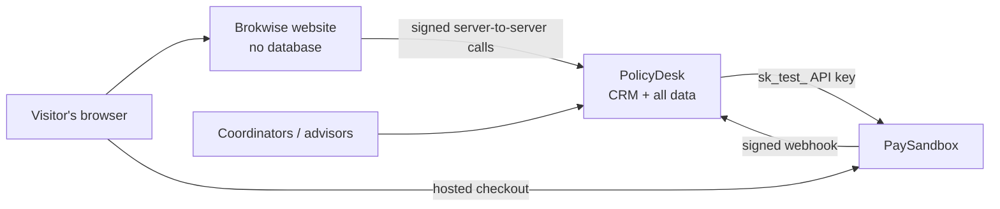

# Brokwise knowledge base

Brokwise is a made-up insurance broker's public website. It sells many lines of business over time;
only **car** is built today. It is a demo merchant for PaySandbox (a fake payment gateway) and uses
PolicyDesk (an insurance CRM) as its back office. All people, insurers and numbers are made up.

Pages in this folder:
- this overview: what Brokwise is, the three systems, the journeys and what step 1 ships;
- [future-scope.md](future-scope.md): what is planned later and what triggers it.

The full design is in [`docs/superpowers/specs/2026-11-11-brokwise-design.md`](../superpowers/specs/2026-11-11-brokwise-design.md).

## The three systems

| System | Owns |
| --- | --- |
| **Brokwise website** (this repo) | Marketing and journey pages, forms, and later the plans, payment and thank-you pages. Stores nothing except a signed journey cookie. |
| **PolicyDesk** | All data: opportunities, leads, plans, orders, payments, automatic assignment and the audit timeline. The private website API. The only holder of the PaySandbox key. |
| **PaySandbox** | Checkout sessions, hosted checkout, payment events and webhooks. |

The website never writes to PolicyDesk's database. Every call goes to PolicyDesk's private API under
`/api/website/v1/`, signed with a shared secret:

- headers `x-brokwise-timestamp` (unix seconds) and `x-brokwise-signature` (lowercase hex);
- signature = HMAC-SHA256(`WEBSITE_API_SECRET`, `${timestamp}.${METHOD}.${pathAndQuery}.${rawBody}`);
- PolicyDesk refuses a request that is unsigned, wrongly signed, or more than 5 minutes off its clock.

The code is in `src/lib/signature.ts` (signing) and `src/lib/policydesk.ts` (the client).

## Journeys

**A. Self-serve ("Get prices now")**
1. The visitor fills the full form (car, driver, contact). PolicyDesk creates the opportunity and the
   lead together and assigns a coordinator automatically.
2. Later steps: plans with add-ons, a payment page through PaySandbox, and a thank-you page with the
   advisor assigned after payment.

**B. Assisted ("Call me back")**
1. The visitor fills the short form (name, mobile, email, car make, model, year). PolicyDesk creates the
   opportunity only and assigns a coordinator automatically.
2. Later steps: the coordinator completes the details in PolicyDesk, converts it to a lead and sends a
   private payment link.

One rule for both: the coordinator owns everything before payment; the advisor comes in after payment.

## What step 1 ships

| Page | What it does |
| --- | --- |
| `/` | Home: lines of business as cards (only Car is active), a made-up trust strip. |
| `/car` | Choice between "Get prices now" (full form) and "Call me back" (short form). |
| `/car/quick` | Short form. |
| `/car/details` | Full form. |
| `/car/received` | "Request received": lead reference (full form), next steps, and the coordinator card in the header, or the help desk card when nobody is available. |

Every form page shows: "Demo site: use made-up details. Payments are in PaySandbox test mode."

**Journey cookie.** After a form is sent, the website stores the opportunity's public id in the
`bw_journey` cookie: a signed (HS256) token, http-only, `SameSite=Lax`, secure in production, valid
for 7 days. `/car/received` reads it; when it is missing or forged the visitor goes back to `/car`
and PolicyDesk is not called.

**Errors.** When PolicyDesk rejects a field, the error is shown under that field. Any other failure
(PolicyDesk down, slower than 8 seconds) shows "We couldn't send your request. Please try again."

**Automatic assignment** happens in PolicyDesk: among active and available coordinators in the car
department, the one with the fewest open records; ties go to the one assigned longest ago. When nobody
is available, the website shows the Brokwise help desk instead of a person.
