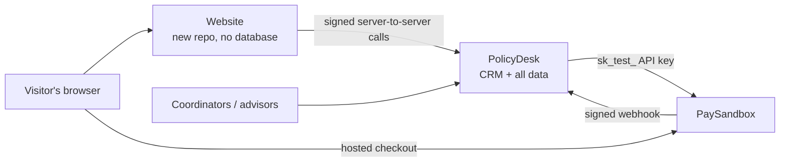

# Brokwise website + PolicyDesk + PaySandbox: design

Date: 2026-11-11 · Status: **approved by Abdul 2026-11-11** ("ap bnao … push bhi kardo repo bna kar") · Name: **Brokwise** (Abdul, 2026-11-11; free on GitHub `AbdulSubhan1/brokwise` and `brokwise.vercel.app` when checked)

This file lives in the shared notes folder until the website repo exists; it moves to
`docs/superpowers/specs/` in that repo when the repo is created.

## 1. Why

PaySandbox (https://paysandbox.vercel.app) is Abdul's fake payment gateway ("Stripe test mode as a
product"). It needs a real-looking merchant that pays through its public API, so both grow together
and act like the real world. The merchant, **Brokwise**, is an insurance broker (car first), modelled on the shape of
InsuranceMarket.ae's car flow (lead form → plans → add-ons → payment → advisor), with PolicyDesk
(Abdul's existing insurance CRM, `~/policydesk`, live at https://policydesk-opal.vercel.app) as its
back office.

Work goes in small steps, each built, tested and shipped before the next, the way PaySandbox
Plans 1–3 went. Every later step adds one more real-world scenario (a payment case, a CRM rule).

## 2. Goals, non-goals, anti-goals

**Goals**
- A public broker website (car first) where a visitor can go from form to paid order in one sitting
  (self-serve), or leave a short form and be helped by a coordinator (assisted).
- PolicyDesk receives every opportunity and lead, assigns people automatically, and is the only
  system that talks to PaySandbox.
- Every payment shows up in the PaySandbox dashboard like any merchant's would.
- Simple screens; working functionality (Abdul: "keep it simple with UI but functionality can be done").

**Non-goals (for now)**
- Email or phone verification (future scope, §11).
- Split payments between sellers; in-page card form instead of the hosted checkout (future scope).
- SEO content pages, other products than car, customer document upload on the website.
- Editing screens for add-ons in step 1 (seeded data first).

**Anti-goals (a failure even if it works)**
- Anything that copies InsuranceMarket.ae's name, logo, copy, styling or insurer data, or uses the
  office design system. Insurers, plans, coordinators and advisors are made up.
- The website writing to PolicyDesk's database directly.
- Real card numbers anywhere; a way to hide PaySandbox's TEST MODE banner.
- Paid services or Abdul's office accounts.

## 3. Constraints

- Free tiers only, personal accounts only (GitHub AbdulSubhan1, his Vercel, Neon, Upstash).
- Repo creation, pushes, merges and deploys each need Abdul's explicit yes. Never `--no-verify`.
- `~/paysandbox` is owned by another session; changes there go through that session
  (local_f5939d04-329f-49d9-8c22-a523e7ad59b9). This design needs **none** (see §8).
- `~/policydesk` is not edited from the brainstorming session. PolicyDesk work runs in its own
  session with Abdul's go-ahead. Its checkout is currently on branch `docs/crm-kit-design`, which
  another piece of work (crm-kit) uses, so PolicyDesk work starts on its own branch/worktree off `main`.
- Tests: per step, only the touched specs, run once at the end of the step. Nobody watches CI.

## 4. The three systems

| System | Owns | Decided by |
| --- | --- | --- |
| **Website** (`~/brokwise`, GitHub `AbdulSubhan1/brokwise`, Vercel project `brokwise`) | Marketing and journey pages, forms, plans page, payment page, thank-you page. Stores nothing except a signed journey cookie. Grows into a large SEO/marketing site later, so it stays apart from the CRM. | Abdul |
| **PolicyDesk** (`~/policydesk`) | All data: opportunities, leads, insurers, plans, add-ons, selections, orders, payments, assignment, audit timeline. The private website API. The only holder of the PaySandbox key and the webhook. | Abdul |
| **PaySandbox** | Checkout sessions, hosted checkout, payment events, webhooks. Used as-is. | existing |

Why APIs in PolicyDesk and not a shared database: the rules (statuses, audit trail, scopes, plan
checks) stay in one place, schema changes can't break the website, secrets stay in one app, and it is
how a real broker's front site talks to its core system. (Agreed with Abdul.)

**No middle API server yet (Abdul agreed, 2026-11-11).** A separate API-only service between the
website and the CRM, like the CAPI layer at Abdul's office, was considered. It is not built now: there
is one website and one product, and the logic for steps 1–4 is small, so a third app would add a
repo, database, deploy and test suite for little gain. Instead, the website and payment logic lives
in its own folders inside PolicyDesk (`server/website/` and `server/payments/`), which never import
from PolicyDesk's screens or feature components, so it can be lifted into an API server later by
moving those folders. Triggers for building that server: a second app needs the same API, a real
pricing engine arrives, or payments grow (split payments, several merchants).

**A multi-line broker, car first (Abdul, 2026-11-11).** The business is a broker that will sell many
lines of business (personal and business insurance), like PolicyDesk's 11 products across
departments. Only car is built now, but nothing is car-only by accident:
- the brand and home page are broker-wide (not car-named); each line has its own URL prefix
  (`/car/...` now, `/health/...`, `/business/...` later);
- every API call carries `product` (`"car"` today), and PolicyDesk's existing product → department
  mapping picks the department and the coordinator pool;
- product-specific form fields live in a per-product Zod schema (`details` on the opportunity), so a
  new line adds a schema and pages, not new tables.
No generic form engine or multi-product UI is built until the second line arrives **[my call, to
avoid building ahead]**.

## 5. Journeys

### A. Self-serve (full form, one sitting)
1. Visitor fills the **full form** (car + driver + contact). Website calls PolicyDesk → **opportunity
   and lead created together**; a **coordinator** is assigned automatically.
2. Visitor sees **plans** with add-ons, picks one, ticks optional add-ons.
3. **Payment page** on the website (plan, add-ons, total, terms checkbox) → **Pay** → PaySandbox
   hosted checkout → back to the website.
4. PaySandbox webhook → PolicyDesk marks the order **paid** and assigns an **advisor** automatically.
5. **Thank-you page** shows the paid order and the advisor. Journey ends.

### B. Assisted (short form, pay later)
1. Visitor fills the **short form** (name, mobile, email, car make/model/year). PolicyDesk creates the
   **opportunity only** and assigns a coordinator automatically. Website shows "your coordinator will
   call you" with the coordinator card.
2. Coordinator calls, fills the remaining details in PolicyDesk, **converts to a lead**, picks the plan
   and add-ons with the customer, and presses **Send payment page**.
3. PolicyDesk creates a private link `brokwise.vercel.app/pay/<token>` (expires; dead once paid). Coordinator
   copies it to the customer (no email/SMS sending).
4. Customer opens it → same payment page and thank-you page as journey A. Advisor assigned after
   payment.

**One rule for both:** the coordinator owns everything before payment; the advisor comes in after
payment. The website header shows the coordinator before payment and the advisor on the thank-you
page (badge + hover card: name, email, phone).

## 6. Automatic assignment (PolicyDesk)

No manual assignment. Runs inside PolicyDesk:
- **Coordinator:** when an opportunity is created from the website.
- **Advisor:** when a payment for that lead succeeds.

Rule: among **active and available** users with the right role in the product's department (car →
`motor_marine`), pick the one with the **fewest open** records (coordinators: opportunities in
`new`/`contacted`/`qualified`; advisors: leads not `won`/`lost`); tie → the one assigned longest ago.
One person can hold many. Each assignment is written to the lead/opportunity timeline with the reason.
If nobody is available, the record stays unassigned and is shown as such in PolicyDesk; the website
shows a generic helpline card instead of a person. **[my call]**

Availability is a new `available` flag on users, set by admins on the Users page. **[my call]**
Reassigning when someone does not respond in time is a later step (needs a scheduler; Vercel Hobby
crons run once a day, so it would use QStash).

## 7. PolicyDesk website API

Private, server-to-server only. Lives under `/api/website/v1/` in PolicyDesk.

**Auth:** each request carries a timestamp and an HMAC-SHA256 signature of method + path + timestamp +
body, made with a shared secret (`WEBSITE_API_SECRET`, same value in both apps). Refused if missing,
wrong, or older than 5 minutes. No CORS. Every request and its result is audit-logged against the
record it touches. **[my call on the exact scheme]**

**Ids:** the website never sees serial ids. Opportunities get a `public_id` UUID like leads already have.

| Step it arrives in | Endpoint | Does |
| --- | --- | --- |
| 1 | `POST /opportunities` | Body: `form: "short" \| "full"` + fields. Creates the opportunity (source `website`); with `full`, also the lead. Assigns the coordinator. Returns public ids, lead reference, and the assigned person (name, email, phone) or null. |
| 1 | `GET /opportunities/{publicId}` | Status and the person to show in the header. |
| 2 | `GET /opportunities/{publicId}/plans` | Plan cards for the car: insurer, plan, cover, price, excess, benefits, add-ons (included / optional / pre-ticked, each with price). |
| 2 | `PUT /opportunities/{publicId}/selection` | Plan id + ticked optional add-on ids. PolicyDesk prices it itself; never trusts prices from the website. |
| 3 | `GET /payments/{publicIdOrPayToken}` | Payment summary: line items and total; or `expired` / `already_paid`. |
| 3 | `POST /payments/{publicIdOrPayToken}/start` | Creates the PaySandbox checkout session; returns its URL. |
| 3 | `GET /orders/{publicId}` | Paid or not, line items, the advisor. |

The webhook `POST /api/paysandbox/webhook` is PaySandbox → PolicyDesk directly, not part of this API.

## 8. Payment with PaySandbox

Uses PaySandbox exactly as it is today (checked against its v1 design and Plan 1):
- **Currency: USD.** PaySandbox is adding a per-project currency (PKR, USD, AED, SAR, GBP, EUR; all
  2 decimals, amounts in the smallest unit). The website's PaySandbox project is created as **USD**
  to match PolicyDesk (`CURRENCY = "USD"`, whole dollars), so there is no conversion: PolicyDesk
  multiplies its whole-dollar amounts by 100 for cents. Checkouts may omit `currency`; naming another
  one is refused with `currency_mismatch`. (Told by the PaySandbox session on 2026-11-11; being built
  there now, so step 3 depends on it being live.)
- `POST /api/v1/checkout_sessions` with `sk_test_` key and `Idempotency-Key`; `amount` integer in
  cents, `line_items` 1–20 of `{ name, quantity, amount ≥ 0 }` (so included
  add-ons go in at 0), `success_url`, `cancel_url`, optional `customer_email`. Session expires in 24 h.
- No `metadata` field, so PolicyDesk stores the `cs_test_…` id on its order row and matches webhooks
  by session/payment id.
- Daily caps on the free merchant: 200 checkout sessions, 1,000 API requests.
- Line items: the plan (with insurer name), each included add-on at 0, each paid add-on. **No tax line**
  for now **[my call; Abdul did not ask for one]**; if added later it goes in as its own line item, since PaySandbox has no tax field.
- The webhook is verified by signature and handled once per event id. `payment.succeeded` → order
  paid → advisor assigned → audit entry.

**How payment fits PolicyDesk's booking rules (Abdul, 2026-11-11):** today a policy is booked only
after an accepted quote, approved KYC and all documents, and finance records the payment afterwards.
Online payment comes first, so:
- On `payment.succeeded`, PolicyDesk creates a **paid order** for the lead (new `orders` table: lead,
  quote, line items, total, PaySandbox session and payment ids, status) and marks the chosen quote
  **accepted**. No policy is booked yet.
- The advisor assigned after payment does KYC and documents as today, then books the policy. Booking
  sees the paid order and sets the policy's payment to **paid** at once, so there is no finance step
  for online payments.
- **Online becomes a supported payment method in PolicyDesk:** a new `online` value in
  `PAYMENT_METHODS` (beside card, bank transfer, cheque, cash), with the PaySandbox `pay_…` id as the
  payment reference, shown as "Online (PaySandbox)". Finance's manual methods stay for everything else.
- Refunds (a later step) refund the order through PaySandbox, and cancel the policy if one was booked.

## 9. Security baseline

Built in from step 1:
- Signed server-to-server API (§7); the browser never sees the secret.
- Zod validation on both sides, size limits, unknown fields rejected.
- Prices worked out only by PolicyDesk from plan and add-on ids.
- No guessable ids: journeys use UUIDs plus a signed, http-only journey cookie, so only the browser
  that started a journey can see its plans or pay. `/pay/<token>` tokens are long and random, expire,
  and die once paid.
- PaySandbox webhook signature check + idempotency by event id.
- Thank-you page shows masked email and phone only.

Added in a later step (§10): Cloudflare Turnstile on forms and per-IP rate limits (Upstash Redis free).

## 10. Steps

Each step is its own plan, built, tested (touched specs only, once) and shipped before the next.

| Step | What ships | Done when |
| --- | --- | --- |
| **1. Leads reach the CRM** | Website repo (car page, short form, full form, "request received" page, coordinator header card) on Vercel. PolicyDesk: `public_id` on opportunities, car details stored on the opportunity, `available` flag, coordinator auto-assignment, `POST/GET /opportunities`, signed API. | On the live site, both forms create records in live PolicyDesk with a coordinator assigned and a timeline entry; the website shows that coordinator. |
| **2. Plans and selection** | PolicyDesk: add-ons per plan (included / optional / pre-ticked, price), seeded made-up car plans, plans + selection API; selection saved on the lead (as a quote). Website: plans page with add-ons. | A picked plan and add-ons show on the lead in PolicyDesk with the right total. |
| **3. Self-serve payment** | Payment page, PaySandbox checkout, webhook, order paid, advisor auto-assignment, thank-you page with advisor card. | A test-card payment on the live site shows in the PaySandbox dashboard and as paid in PolicyDesk with an advisor assigned. |
| **4. Assisted flow** | Coordinator completes details, converts, **Send payment page**; `/pay/<token>` on the website. | A coordinator-sent link is paid later and lands like step 3. |
| **5. Hardening** | Turnstile, rate limits. | Bot/rate tests pass. |
| **6+. One scenario each** | Declined card, OTP card, link expiry, refund from PolicyDesk (→ policy cancelled), dispute, webhook retries/duplicates, reassignment on no response. | Per scenario. |

### Step 1 detail

**Website pages**
- `/` Brokwise home (broker-wide): the lines of business as cards, only **Car** active (others
  "coming soon"), short trust strip (made-up numbers).
- `/car` car insurance page: one "Get quotes" button and a choice between "Get prices now" (full
  form) and "Call me back" (short form).
- Every page with a form shows the "Demo site: use made-up details" notice.
- `/car/quick` short form: name, mobile, email, car make, model, year.
- `/car/details` full form: car (make, model, year, GCC spec yes/no, car value), driver (name, date of
  birth, nationality, city, years licensed), contact (email, mobile).
- `/car/received` "request received": reference, what happens next, coordinator card in the header
  (or helpline card if nobody is available).
- Car makes/models: a small made-up fixed list in the website. **[my call]**

**PolicyDesk changes**
- First commit: the `AGENTS.md` exception for the two API route groups and the `middleware.ts`
  change that lets them past the login redirect (§13.3).
- `opportunities.public_id` (UUID) and `opportunities.details` (jsonb, validated by a Zod schema per
  product; car fields above), shown read-only on the opportunity page.
- `users.available` (boolean, default true) with a toggle on the admin Users page.
- Assignment service (§6) for coordinators.
- `/api/website/v1/opportunities` POST + GET with the signature check.
- Seed: at least two made-up coordinators and two advisors in `motor_marine`.
- KB page "Website and online payments" in `docs/` (§11).

**Website setup** **[my call]**: Next.js 16 App Router + TypeScript strict + Tailwind CSS 4, like
PaySandbox; Vitest for unit tests, Playwright for E2E; no database. Env: `POLICYDESK_API_URL`,
`WEBSITE_API_SECRET`, `JOURNEY_COOKIE_SECRET`. KB in `docs/kb/` (§11). The design doc moves to
`docs/superpowers/specs/`.

**Tests (run once at the end)**
- PolicyDesk: unit tests for the signature check (valid, wrong, stale, missing) and the assignment rule
  (fewest open, tie, nobody available); one API test per endpoint; existing `npm run check`.
- Website: unit test for request signing; one Playwright spec per form (submit → received page shows
  a person), against a local PolicyDesk.

## 11. Future scope (keep in the KB)

**Knowledge base (Abdul asked, 2026-11-11):** step 1 adds a KB to both repos, and every later step
keeps it current:
- Website repo: `docs/kb/` with an overview, the journeys (§5), the three systems (§4) and a
  `future-scope.md` page holding the list below (including the middle API server and its triggers).
- PolicyDesk: its existing `docs/` KB (shown at `/kb`) gets a "Website and online payments" page:
  the website API, automatic assignment, the online payment method, orders, and the same future
  scope list.
Until the repos exist, the list lives in this doc and in `future-scope.md` beside it in the shared
notes folder.

- Email OTP verification before plans are shown.
- Split payments between sellers (broker vs partner company), as on the reference site.
- In-page card form (Elements-style) instead of the hosted-checkout redirect.
- SEO and content pages; more products; customer document upload on the website.
- Add-on editing screens in PolicyDesk.
- A middle API server (CAPI-style) holding website journeys, pricing and payments, once a trigger
  in §4 is hit.

## 12. Left to the builder

Folder layout inside the website repo, component structure, exact styling (simple, own look, mobile
first), the exact Zod field limits, error copy, test file names.

### Calls made after the builder check **[my calls]**

- **Pricing in step 2 is a flat price per plan plus add-ons.** No rating from car value, age or
  driver yet; the extra form fields are stored for the coordinator and for a later rating step.
- **Automatic assignment applies only to opportunities with source `website`.** PolicyDesk's
  existing manual convert/assign screens stay as they are for everything else.
- **Who counts as a coordinator or advisor** is decided by role (Coordinator / Advisor), not by
  permission, so granting coordinators quote permissions in step 4 does not make them advisors.
- **A coordinator's workload** counts opportunities in `new`/`contacted`/`qualified` **plus**
  website leads not yet paid, so self-serve journeys count too.
- **Demo data warning:** PolicyDesk's live demo lets anyone sign in as any role, so the website shows
  a permanent "Demo site: use made-up details" notice next to the forms. Cleaning up old
  submissions is a later step.
- **Unit tests in PolicyDesk:** step 1 adds a unit test runner (it only has Playwright today).

## 13. Open questions (Abdul's)

All answered on 2026-11-11:
1. ~~What a paid online order becomes~~ settled: paid order + accepted quote; advisor does KYC,
   documents, booking; online is a supported payment method (§8).
2. ~~Currency~~ settled: USD (PaySandbox per-project currency, §8). Tax line: none for now
   **[my call]** (5% VAT came from the UAE reference site).
3. ~~API exception~~ settled (Abdul approved): PolicyDesk's `AGENTS.md` gets a written exception
   allowing exactly two API route groups, `/api/website/v1/*` (HMAC signature instead of a login)
   and `/api/paysandbox/webhook` (PaySandbox signature). Both are let past the login redirect in
   `middleware.ts`. The business logic lives in shared server code used by the screens and these
   routes alike; every other path keeps "no API routes". This rule change is the first commit of
   PolicyDesk's step 1 so the AI PR reviewer accepts the rest.
4. ~~Name~~ settled: **Brokwise**.
